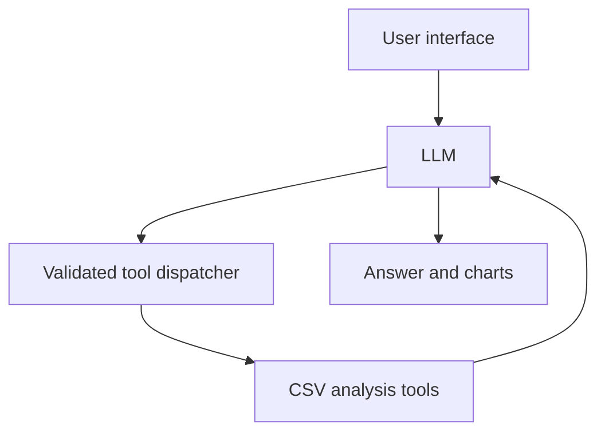

# Project Proposal — Semester Week 10

## Project Title

CSV Data Analyst Assistant

Student: Erzhan Aknur
Course: CSS 4007 — Artificial Intelligence

## Problem Description

CSV files are often used to store data. However, beginners may find it difficult to understand a dataset, calculate statistics, and create charts.

This application will allow users to upload a CSV file and ask questions in natural language. An LLM will select suitable tools, and Python functions will perform the calculations. The LLM will explain the results in simple language.

The application will help users perform basic data analysis without writing code.

## Target Users

- Statistics and data science students.
- Beginner data analysts.
- People who need simple analysis of CSV files.

## Selected Difficulty

C — Intermediate.

The application will use a real LLM to select and call tools. It will validate tool arguments, execute Python functions, and return their results to the LLM.

Answers about the dataset will be based on actual tool results.

## Expected Functionality

- Upload one CSV file per session.
- Inspect column names, data types, row count, and missing values.
- Calculate mean, median, minimum, maximum, sum, and count.
- Create bar charts, line charts, and histograms.
- Explain analysis results in simple language.
- Answer general questions that do not require tools.
- Handle invalid files, unavailable data, incorrect arguments, and tool or API failures.
- Record tool execution logs.

The initial version will support UTF-8 CSV files with a header row, up to 5 MB and 50,000 rows.

## Proposed Functions

### 1. load_dataset(file_bytes: bytes, filename: str) -> dict

- Purpose: validate and load an uploaded CSV file.
- Inputs: file bytes and filename.
- Outputs: dataset ID, row count, and column names, or a structured error.
- Dependencies: pandas, Python io, and Streamlit session storage.

This function will run when the user uploads a file. It will not be an LLM-callable tool.

### 2. inspect_dataset(dataset_id: str) -> dict

- Purpose: inspect the structure and quality of the dataset.
- Inputs: the active dataset ID.
- Outputs: column names, data types, row count, missing-value counts, and a small preview.
- Dependencies: pandas and session storage.

### 3. calculate_statistics(dataset_id: str, column: str, metrics: list[str]) -> dict

- Purpose: calculate descriptive statistics for a numeric column.
- Inputs: dataset ID, column name, and requested metrics.
- Outputs: calculated values, valid observation count, and missing-value count.
- Dependencies: pandas and session storage.

Allowed metrics will be mean, median, min, max, sum, and count. Missing values will be excluded and reported. Invalid columns, nonnumeric columns, and columns with no valid numeric values will return clear errors.

### 4. create_chart(dataset_id: str, chart_type: str, x: str, y: str | None = None, aggregation: str | None = None) -> dict

- Purpose: create a chart from selected dataset columns.
- Inputs: dataset ID, chart type, column names, and optional aggregation.
- Outputs: chart artifact ID, title, and a description of the plotted data.
- Dependencies: pandas, matplotlib, session storage, and a controlled output directory.

Allowed chart types will be bar, line, and histogram. The function will validate column types. If repeated x values require aggregation, the agent will ask the user to choose a suitable operation.

### 5. answer_question(question: str, dataset_id: str | None = None) -> dict

- Purpose: manage user requests and the LLM tool-calling process.
- Inputs: user question and an optional active dataset ID.
- Outputs: final answer, optional chart references, and execution status.
- Dependencies: LLM API adapter, tool dispatcher, validation, and logging.

General questions, such as “What is a median?”, can be answered without a dataset or tool call. Questions about an uploaded file must use relevant tool results.

## Proposed Agent Tools

The following functions will be registered as LLM-callable tools using JSON schemas:
### inspect_dataset

The agent needs this tool to obtain the actual column names, data types, and missing-value counts. It helps prevent invented descriptions of the dataset.

### calculate_statistics

The agent needs this tool to obtain accurate numerical results. Python will perform the calculations, and the LLM will explain the results.

### create_chart

The agent needs this tool to create actual charts from the uploaded data.

The LLM will decide which tool to call based on the request. The application will not use fixed keyword rules or a fixed sequence of function calls as a replacement for model selection.

Before execution, the dispatcher will validate the tool name, dataset ID, column names, argument types, and allowed operations. Tool results or structured errors will be returned to the LLM.

## Model Selection

The proposed model is Qwen2.5-7B-Instruct, running locally through Ollama.

This is a preliminary choice. During Week 11, I will check whether the available computer can run the model and whether tool calling works correctly. If a different model or a hosted API is needed, I will document the change and its reason.

The model connection will be separated from the analysis tools through a Python adapter.

## Architecture

The planned technologies are:

- Python for application logic.
- Streamlit for the interface.
- pandas for CSV processing and calculations.
- matplotlib for charts.
- Ollama for connecting to the proposed local LLM.
- pytest for application tests.

Workflow:

1. The user uploads a CSV file.
2. The application validates and loads the file.
3. The user asks a question.
4. The LLM decides whether a tool is needed.
5. If needed, the dispatcher validates and executes the selected tool.
6. The tool result is returned to the LLM.
7. The LLM produces an answer based on the result.
8. The interface displays the answer and any chart.

Requests that do not need tools will receive a direct answer.

The application will limit each request to six tool calls and use a timeout. It will treat uploaded content as data and will not execute arbitrary model-generated code.
## Example Requests

1. “Which columns are in this dataset, and how many missing values does each column have?”
2. “Calculate the mean and median of the sales column.”
3. “Create a line chart of sales by month.”
4. “Show a histogram of customer ages.”
5. “What is the difference between mean and median?” — no tool is required.
6. “Calculate the average of the profit column.” — if the column is missing, explain that the information is unavailable.

## Evaluation Plan
I will use a small student-created sales CSV with manually checked expected results. A second CSV will check that the application works with a different table structure.

The planned tests are:

1. A valid CSV file loads with the correct rows and columns.
2. An empty or malformed file is rejected.
3. A file exceeding the size limit is rejected.
4. Dataset inspection returns correct missing-value counts.
5. Mean and median match manually verified results.
6. A nonexistent column returns a structured error.
7. A numeric calculation on a text column is rejected.
8. A column with no valid numeric values is handled correctly.
9. Valid chart arguments produce a chart artifact.
10. Invalid chart arguments are rejected.
11. A simulated tool failure is handled without crashing.
12. A simulated model connection failure produces a clear message.
13. A general question can be answered without calling tools.
14. A tool-calling integration test checks that tool results are returned to the LLM and used in the final answer.

Unit tests will use controlled datasets and mock model responses. Separate live demonstrations will show actual model selection of inspection, statistics, and chart tools.

Tool logs will record the tool name, validated arguments, status, and a concise result or error. Logs will not include credentials or private model reasoning.

Generated tool-call structures and tool outputs will be validated. Final responses must contain a nonempty answer, and chart references must point to artifacts created by the application. Numerical accuracy will be checked against expected results during evaluation.

Test results and limitations will be documented. The starter repository tests will not count as my application tests.

## Weekly Milestones

| Week | Planned Work |
| --- | --- |
| 10 | Select the topic and C level. Prepare the proposal, architecture, evaluation plan, and weekly report. Set up the required fork. |
| 11 | Set up Python, Streamlit, and the model connection. Check local model performance and tool calling. Implement the first real LLM request. |
| 12 | Implement CSV loading, validation, inspection, and descriptive statistics. Add initial tests. |
| 13 | Register at least two tools and demonstrate real LLM-selected calls. Add chart creation. |
| 14 | Complete the tool-calling workflow, direct answers without tools, clarification behaviour, and tool error handling. |
| 15 | Improve validation, execution logs, request limits, and failure handling. Expand tests. |
| 16 | Run the full evaluation, record results, fix failures, and update documentation. |
| 17 | Complete the final report and README. Submit the repository URL and final commit hash. Demonstrate and defend the application. |

AI assistance disclosure: ChatGPT helped discuss project ideas and draft this proposal. I will review, test, and understand the implementation. Further AI assistance will be documented during development.
